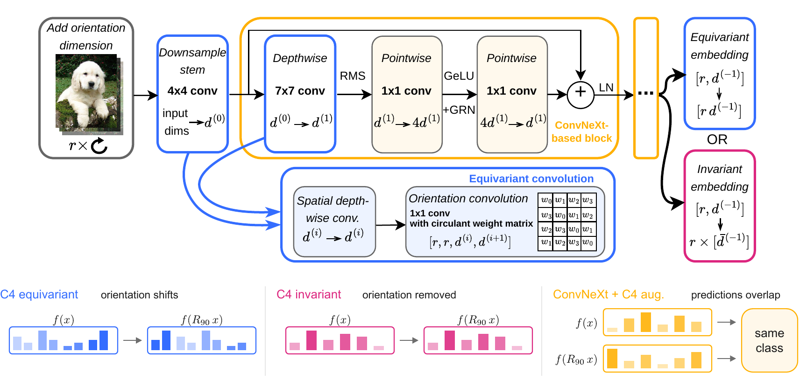

# equivariant-convnext

This repository contains the code for training the equivariant ConvNeXt-C4.
Both equivariant or invariant readout are supported for the model.
Other related architectures available are the standard ConvNext-Small,
ReViT-C4 and the non-equivariant CvT.



ConvNeXt-C4 factorizes each convolution into a spatial depthwise convolution
and an orientation convolution. The later mixes orientation information through
a circulant weight matrix. The final equivariant readout preserves the orientation
features. The invariant readout removes them.

| Model config | Encoder |
|---|---|
| `convnext` | Stock timm `convnextv2_small`, with its original architecture |
| `convnext_c4` | C4 ConvNeXt-Small with the equivariant readout |
| `convnext_c4_inv` | The same C4 backbone with the invariant readout |
| `revit_c4` | REViT-v2 C4 with the equivariant readout |
| `cvt` | CvT-13; non-equivariant counterpart to REViT |

Readout options are `equivariant` and `invariant`. These names describe the
embedding before the classifier.

## Setup

Run training and analysis from a Git checkout with at least one commit.
Each run records the commit ID and local source changes for reproducibility.
A shallow clone is sufficient. A source ZIP without `.git` is not sufficient.

```bash
uv sync
uv run --frozen pytest -q
```

The suite has three checks: ConvNeXt-C4 equivariance under quarter turns, data
loading and augmentations, and compiled training with checkpoint loading. The
training check covers all five model configs and both ImageNet training paths;
it requires CUDA. Tests use small generated image sets and do not download data.

Datasets default to `~/Data`. Set `DATA_ROOT` to change this root.
ImageNet defaults to `~/Data/ImageNet1k`; set `IMAGENET_ROOT` to change it.
The nine downstream datasets are CIFAR-100, PCam, MINC-2500, Caltech-256,
Food-101, OfficeHome, FGVC-Aircraft, SUN397, and Oxford-IIIT Pets.
Caltech uses the recorded 136-class subset.

## Training from scratch

One run:

```bash
uv run --frozen src/train.py model=convnext data=cifar100
uv run --frozen src/train.py model=convnext_c4 data=oxford_pets data.rot_aug=c4
uv run --frozen src/train.py model=convnext_c4_inv data=food101 data.rot_aug=rot30
```

`data.rot_aug` accepts `none`, `c4` (uniform exact quarter turns), or `rot30`
(uniform angles in ±30 degrees, bilinear interpolation, dataset-mean fill).
These settings also apply to ImageNet training. Other augmentations always stay enabled.
Training uses compilation by default. `train.compiler=eager` is available for
explicit eager experiments and CPU checks.

The same bash script trains any model across the panel and three seeds:

```bash
bash scripts/train.sh scratch convnext
DATASETS="cifar100 pcam" SEEDS="0" bash scripts/train.sh scratch revit_c4
CUDA_VISIBLE_DEVICES=1 SEEDS="1" bash scripts/train.sh scratch cvt
```

ImageNet training supports `convnext` and `convnext_c4` and uses DDP, EMA,
Mixup/CutMix, and the fixed 150-epoch recipe:

```bash
GPUS=4 bash scripts/imagenet.sh convnext
GPUS=4 bash scripts/imagenet.sh convnext_c4
```

The default batch is 256 per GPU and 1024 in total. For another GPU count,
set batch settings explicitly. The script uses learning rates 0.001 and 0.003
for ConvNeXt and C4 respectively.

## Fine-tuning

Load EMA encoder weights and initialize a new classifier:

```bash
bash scripts/train.sh finetune convnext \
  train.init_checkpoint=checkpoints/scratch/imagenet1k/convnext/none/seed_0/checkpoints/epoch_150.pt
```

The script uses 30 epochs and the fine-tuning crop recipe. A source checkpoint
must match the encoder architecture. Use `train.init_weights=model` for ordinary
training checkpoints or exported `ema.pt` files.
ImageNet-1K weights for ConvNeXt-C4-Small are available on Hugging Face at
[hlzl/equivariant-convnext-c4-small-in1k](https://huggingface.co/hlzl/equivariant-convnext-c4-small-in1k).

Artifacts are saved under:

```text
checkpoints/<experiment>/<dataset>/<model>/<rotation>/seed_<seed>/
  config.yaml  env.json  source.patch  metrics.jsonl  summary.json  checkpoints/
```

Scratch and fine-tuning runs have separate paths, as do all rotation settings.
Interrupted runs resume only when their config, source, and initialization match.
Completed matching downstream runs are skipped. Training selects checkpoints
by validation macro accuracy and keeps the test set closed by default.
Evaluate selected downstream checkpoints later with:

```bash
uv run --frozen src/evaluate.py <run_dirs> --split test --final-test
```

Evaluation and head averaging use the local dataset root, not the root copied
into a checkpoint config. Both accept `--data-root`.
Evaluation reports cross-entropy loss, accuracy, class macro accuracy, and sample
count.

## Other experiments

### Head averaging

```bash
uv run --frozen src/head_average.py <scratch_run_dirs> <finetune_run_dirs>
```

This experiment uses one frozen encoder pass for the original and averaged
linear heads.

### C2ST orientation accuracy

```bash
uv run --frozen src/c2st.py --controls
uv run --frozen src/c2st.py --datasets cifar100 pcam --seeds 0 --device cuda:1
```

A fixed 20-unit MLP discriminates observed images from the uniform C4 mixture,
including the identity turn. It tests full 64-pixel images and local 32-pixel
patches over three seeds. `summary.json` contains mean accuracy and sample
standard deviation for each dataset and scale, including controls when requested.
These values also give the global–local accuracy gap used in the paper.
`records.json` keeps each seed's accuracy, cross-entropy, class results, and
training history. Each run also saves the source split and selected checkpoint.
